<picture>
  <source media="(prefers-color-scheme: dark)" srcset="./assets/banner-dark.svg">
  <source media="(prefers-color-scheme: light)" srcset="./assets/banner-light.svg">
  
</picture>

# Ngoc Viet (William) Ho

I study Computer Engineering at Cal Poly, San Luis Obispo, and expect to graduate in June 2029. I work on embedded firmware, wireless audio and low-level systems, mainly in C/C++ on ESP32 hardware.

I am looking for **Summer 2027 internships** in embedded systems, firmware, wireless audio or systems engineering. I am available **June 1 through August 31, 2027**, prefer California or remote opportunities and can relocate independently.

[LinkedIn](https://www.linkedin.com/in/ngoc-viet-ho-13a098190/) | [All repositories](https://github.com/WillyBilly06?tab=repositories)

## Engineering Projects

### [Bluetooth Speaker Relay](https://github.com/WillyBilly06/bluetooth-speaker-relay)

I forward encoded SBC between ESP32 speakers over Bluetooth Classic L2CAP without re-encoding the audio. I implemented source election, Bluetooth clock mapping and presentation timestamps, and tested a two-board relay while the source maintained its A2DP connection to a phone. Acoustic phase alignment remains unverified.

### [LHDC V5 Software Decoder](https://github.com/WillyBilly06/LHDC-V5-Decoder)

I reverse-engineered an LHDC V5 software decoder and integrated it into the ESP32 A2DP audio pipeline. I tested 192 kHz, 24-bit, 1 Mbps playback on an ESP32-WROOM without PSRAM. The linked repository records the decoder implementation and integration work; its published setup instructions reflect specific source snapshots.

### [OpenALS Classroom Audio](https://github.com/WillyBilly06/openals-classroom-audio)

I developed audio firmware and a Flutter interface for a classroom listening prototype in the original `datalooper/openals` collaboration. The project uses ESP32 hardware, encrypted ESP-NOW audio and authenticated UDP transport, with room-selection and volume controls. I investigated line-in noise by revising grounding and power paths, then checked the result by listening and with an oscilloscope. Campus deployment and complete mobile audio playback remain in progress.

### [KestrelOS](https://github.com/WillyBilly06/KestrelOS)

I am developing an experimental x86-64 operating system with a custom UEFI loader, kernel, drivers and C userland. I demonstrated its graphical desktop in a virtual machine. Hardware and application compatibility support remain under development.

## Tools and Other Work

- **Languages:** C, C++, Kotlin and Dart.
- **Embedded and wireless:** ESP-IDF, FreeRTOS, Bluetooth A2DP, L2CAP, BLE GATT, ESP-NOW and I2S audio.
- **Development:** Git, CMake, Flutter, signal-path debugging and oscilloscope measurements.
- [Multi-codec A2DP firmware](https://github.com/WillyBilly06/ESP32-S31-A2DP-Codecs) and [Android speaker controls](https://github.com/WillyBilly06/BDK-AUDIO-APP).
- [Codex Windows memory repair](https://github.com/WillyBilly06/codex-windows-memory-repair): an unofficial repair for one specific app version, with a separate local copy.

Recent repository activity

<!--RECENT_REPO:START-->
🛠️ Most recently pushed to <a href="https://github.com/WillyBilly06/codex-windows-memory-repair"><b>codex-windows-memory-repair</b></a> on <b>2026-10-11</b> 
<i>Unofficial version-locked Windows x64 Codex history-memory repair. Creates a separate local copy; original installed app remains unchanged.</i> 
<code>C#</code>
<!--RECENT_REPO:END-->

